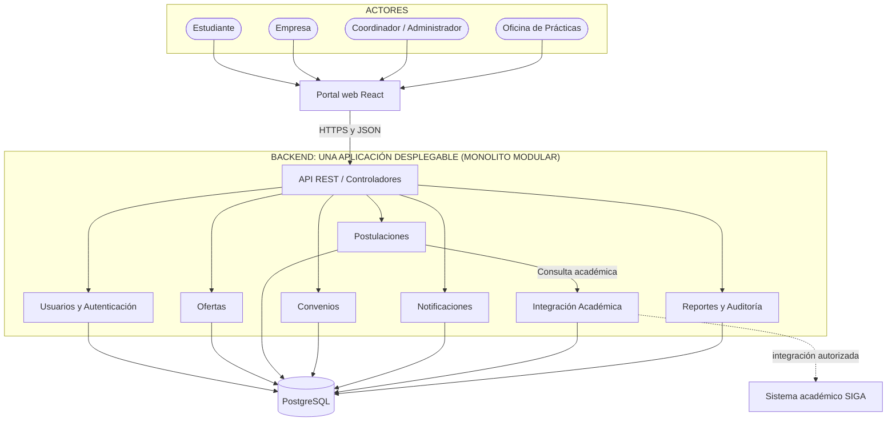

# Arquitectura Inicial del Sistema

## Estilo arquitectónico

El sistema se propone como un **monolito modular**: el backend se construye y despliega como una sola aplicación, pero su código se divide en módulos de negocio con responsabilidades e interfaces claras. Cada módulo se organiza internamente con Clean Architecture (dominio, aplicación e infraestructura).

## Referencia: Bumeran

Por indicación de la docente, la arquitectura toma como referencia funcional a **Bumeran**, un portal de empleo de alcance regional. En esta propuesta no se dispone de documentación verificable de su arquitectura interna; por ello, la referencia es **funcional y de dominio** (qué capacidades ofrece y cómo se relacionan sus actores), no una réplica técnica.

Capacidades observables de Bumeran y su equivalente en este sistema:

| Capacidad en Bumeran | Equivalente en el sistema UNSCH | Módulo |
|---|---|---|
| El candidato crea una cuenta y mantiene su CV/perfil. | El estudiante tiene una cuenta con rol y datos académicos. | Usuarios y Autenticación |
| La empresa crea una cuenta de empresa y publica avisos. | La empresa se registra, es validada por el coordinador y publica ofertas de prácticas. | Usuarios y Autenticación, Ofertas |
| Búsqueda de avisos con filtros. | Búsqueda de ofertas filtradas por carrera, ciclo y modalidad (RF03). | Ofertas |
| El candidato se postula a un aviso. | El estudiante postula a una oferta, con validación de elegibilidad y sin duplicados (RF04, RF05). | Postulaciones, Integración Académica |
| El candidato consulta el seguimiento de sus postulaciones. | Avisos internos de nuevas ofertas y cambios de estado (RF07). | Notificaciones |
| La empresa gestiona candidatos de sus avisos. | La empresa evalúa postulantes; el coordinador da seguimiento al convenio (RF06). | Postulaciones, Convenios |

**Diferencias deliberadas respecto a Bumeran** (por el contexto institucional):

- Las empresas y las ofertas pasan por **validación del coordinador** antes de ser visibles (RF01, HU-02). Esta aprobación académica es una regla institucional propia; no supone que Bumeran carezca de moderación.
- No hay planes de pago ni avisos destacados (RC01).
- La elegibilidad incorpora requisitos académicos consultados mediante Integración Académica (RF04, RC02), siempre sujetos a acceso autorizado.
- Se añaden **convenios**, **auditoría** y **reportes** para responder a las necesidades de la Oficina de Prácticas de la UNSCH.

## Diagrama de arquitectura

El siguiente diagrama representa la arquitectura propuesta para el **Sistema Web para la Gestión y Publicación de Prácticas Preprofesionales (UNSCH)**. La única base de datos es PostgreSQL.

Cada módulo del backend contiene sus propias capas de Clean Architecture (dominio, aplicación e infraestructura); no existen capas globales compartidas entre módulos. Esa estructura interna se detalla en [Enfoque de Clean Architecture](enfoque/enfoque-arquitectonico.md).

## Responsabilidades principales

| Módulo | Responsabilidad |
|---|---|
| Usuarios y Autenticación | Identidad, credenciales, perfiles de usuario y permisos por rol. La cuenta de empresa se vincula con el perfil empresarial gestionado por Ofertas. |
| Ofertas | Perfil y validación de empresas como subfunción interna; registro, revisión, publicación, edición, cierre y búsqueda de ofertas. La empresa y cada oferta se aprueban por separado. |
| Postulaciones | Registro, consulta de elegibilidad por contrato, prevención de duplicados, evaluación por la empresa, selección/rechazo y seguimiento de candidaturas. |
| Convenios | Gestionar el convenio del estudiante seleccionado y el seguimiento de su práctica, manteniendo entidades y estados separados. |
| Notificaciones | Crear y consultar avisos internos por destinatario sobre ofertas, cambios de estado y revisiones pendientes; guardar lectura en PostgreSQL. |
| Integración Académica | Encapsular consulta y traducción de antecedentes académicos mediante un adaptador autorizado; distinguir elegibilidad, incumplimiento e indisponibilidad. |
| Reportes y Auditoría | Registro de acciones administrativas y reportes por periodo y carrera (RF09, RF10). |

## Consideraciones de diseño

- Los módulos forman parte de la misma aplicación y no son microservicios desplegados por separado.
- La base de datos PostgreSQL es la única persistencia de la primera versión. Cada módulo es dueño de sus tablas (por ejemplo, un esquema por módulo) y no consulta directamente las tablas de otro módulo.
- Las reglas de negocio deben estar en el dominio y los casos de uso, no dentro de los controladores HTTP.
- PostgreSQL es la única base de datos. No se incorporan Redis, RabbitMQ ni microservicios; [ADR-003](decisiones-arquitectonicas.md) documenta esta simplificación.
- La integración real con SIGA depende de los mecanismos de acceso que autorice la universidad.
- El diagrama es una propuesta conceptual. Debe actualizarse cuando se confirme la estructura real del código y la tecnología del backend.

## Definición detallada de los siete módulos

Se conservan los **siete módulos originales**. El perfil de empresa es una subfunción de Ofertas; el seguimiento de la práctica es una subfunción de Convenios. No se añaden módulos de Empresas o Prácticas independientes.

### 1. Usuarios y Autenticación

**Propósito:** identificar a cada persona y controlar qué operaciones puede realizar.

- Gestiona cuentas, credenciales, rol y asignación de escuela o ámbito institucional.
- Autentica a estudiantes, representantes de empresas, coordinadores y administradores.
- El personal de la Oficina de Prácticas accede con cuenta individual y permiso de reportes.
- Datos propios: usuario, credencial protegida, rol y asignación de ámbito.
- Contrato interno: obtener identidad y comprobar permisos. Cada caso de uso también valida la propiedad y el ámbito del recurso.
- **Límite:** crear una cuenta empresarial no aprueba el perfil de empresa ni sus ofertas; esas decisiones pertenecen a Ofertas.

### 2. Ofertas

**Propósito:** administrar las oportunidades que la universidad autoriza a publicar.

- Mantiene el perfil empresarial vinculado a una cuenta de Usuarios; el coordinador aprueba o rechaza ese perfil.
- La empresa validada crea ofertas con carrera, ciclo mínimo, créditos cuando correspondan, modalidad, vacantes y fecha límite.
- El coordinador revisa cada oferta por separado; solo las aprobadas, vigentes y no cerradas se muestran al estudiante compatible.
- Gestiona edición, revisión, cierre, búsqueda, filtros y paginación.
- Datos propios: perfil de empresa, validación de empresa, oferta, requisitos y estado de publicación.
- Contratos públicos: consultar empresa validada y consultar oferta para postular. Devuelve DTO de requisitos/estado, sin exponer tablas ni repositorios privados.
- **Límite:** no registra candidaturas ni decide que un estudiante es académicamente elegible.

### 3. Postulaciones

**Propósito:** administrar la candidatura de un estudiante a una oferta.

- Obtiene los requisitos y la vigencia a través del contrato público de Ofertas.
- Solicita a Integración Académica la verificación y registra la candidatura solo si el resultado es válido.
- Impide duplicados mediante regla de aplicación y restricción única estudiante–oferta en PostgreSQL.
- Permite consultar candidaturas propias y a la empresa evaluar únicamente candidatos de sus ofertas.
- Gestiona estados de candidatura como registrada, en revisión, seleccionada y rechazada; las transiciones se validan en el servidor.
- Datos propios: postulación, fecha, requisitos aceptados, estado e historial de evaluación.
- **Límite:** seleccionar a un candidato no crea ni activa automáticamente un convenio. Las vacantes limitan selecciones, no la cantidad de postulantes.

### 4. Convenios

**Propósito:** dar seguimiento institucional al convenio y a la práctica de un estudiante seleccionado.

- Verifica la selección mediante un contrato público de Postulaciones.
- Mantiene datos del convenio, responsables, fechas y evidencias que defina la universidad.
- Distingue el estado del documento de convenio del avance de la práctica.
- Datos propios: convenio y seguimiento de práctica, con sus respectivos historiales.
- Contratos públicos: consultar estado de convenio/práctica y actualizarlo con autorización del coordinador.
- **Límite:** no evalúa postulantes ni sustituye la evaluación curricular o la certificación oficial (RC03).

### 5. Notificaciones

**Propósito:** informar a los usuarios sobre hechos relevantes del proceso.

- Registra avisos de ofertas nuevas compatibles, cambios de estado y revisiones pendientes.
- Cada aviso tiene destinatario, motivo, recurso relacionado, fecha y estado de lectura.
- Datos propios: notificación interna y lectura, almacenadas en PostgreSQL.
- Contratos públicos: registrar aviso, listar avisos propios y marcar como leído.
- **Límite:** no decide aprobaciones o selecciones; informa decisiones tomadas por otros módulos.
- Para la versión base no se requiere correo/SMS, un broker ni un servicio desplegado por separado.

### 6. Integración Académica

**Propósito:** aislar el acceso al sistema académico y traducir sus respuestas al lenguaje del proyecto.

- Expone un contrato estable para verificar carrera, ciclo y créditos requeridos.
- El adaptador autorizado consulta SIGA sin que Postulaciones conozca su API, credenciales o formatos.
- Devuelve resultados distintos: elegible, no elegible, verificación no disponible y fallo técnico.
- Puede conservar en PostgreSQL la referencia y fecha de una verificación para trazabilidad; no replica matrícula ni notas como sistema académico alternativo.
- **Límite:** una integración pendiente o fallida no equivale a aprobación. Sin acceso autorizado, el prototipo usa un doble de prueba claramente identificado; no se presenta como validación institucional real.
- Si se requiere una alternativa manual en operación, deberá definirse con la universidad antes de implementar; no se introduce como requisito confirmado.

### 7. Reportes y Auditoría

**Propósito:** ofrecer información institucional y trazabilidad de decisiones.

- Reportes: dashboard por periodo/carrera y exportaciones PDF/Excel respetando permisos y filtros.
- Auditoría: actor, acción, recurso, fecha, resultado y motivo de decisiones administrativas.
- Mantiene ambas subfunciones diferenciadas dentro del mismo módulo.
- Datos propios: registros de auditoría; las consultas de negocio usan contratos públicos de los módulos propietarios.
- **Límite:** un reporte no modifica una postulación o convenio; auditoría no guarda contraseñas, tokens ni secretos.

## Comunicación entre módulos

Las llamadas se realizan **en memoria dentro del mismo backend**, mediante contratos públicos:

| Origen | Destino | Motivo |
|---|---|---|
| Ofertas | Usuarios y Autenticación | Identificar cuenta empresarial y permisos del actor. |
| Postulaciones | Ofertas | Consultar requisitos y revalidar vigencia al registrar. |
| Postulaciones | Integración Académica | Verificar elegibilidad del estudiante. |
| Convenios | Postulaciones | Confirmar selección antes de gestionar el convenio. |
| Ofertas, Postulaciones y Convenios | Notificaciones | Registrar avisos a sus destinatarios. |
| Operaciones administrativas | Reportes y Auditoría | Auditar decisiones y cambios sensibles. |
| Reportes y Auditoría | Contratos de consulta de los módulos | Construir dashboard y exportaciones sin leer tablas ajenas. |

Cada módulo persiste mediante su propio adaptador en la misma PostgreSQL. Las escrituras relacionadas pueden coordinarse con una unidad de trabajo transaccional compartida, sin exponer tablas de otro módulo.

## Referencia funcional y API REST

El portal sigue el flujo de referencia de Bumeran: empresa registra una oportunidad, estudiante consulta y postula, empresa evalúa y el candidato sigue su proceso. La adaptación institucional añade validación académica, aprobación del coordinador y convenios.

Los contenedores funcionales se explican en [C2](diagramas-c4/diagramas-c4.md); las rutas propuestas están en [API REST](api-rest.md). Son contratos de nuestro backend, no endpoints atribuidos a Bumeran.

La evaluación prioriza únicamente AC01 Rendimiento, AC02 Seguridad y AC03 Mantenibilidad, con pruebas de carga de 20 y 25 usuarios simultáneos.
