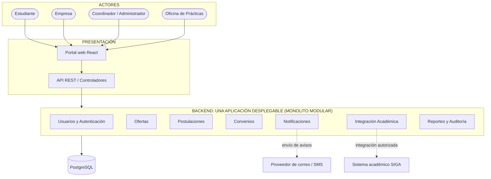

# Arquitectura Inicial del Sistema

## Estilo arquitectónico

El sistema se propone como un **monolito modular**: el backend se construye y despliega como una sola aplicación, pero su código se divide en módulos de negocio con responsabilidades e interfaces claras. Cada módulo se organiza internamente con Clean Architecture (dominio, aplicación e infraestructura).

## Referencia: Bumeran

Por indicación de la docente, la arquitectura toma como referencia funcional a **Bumeran**, un portal de empleo de alcance regional. Bumeran no publica su arquitectura interna, por lo que la referencia es **funcional y de dominio** (qué capacidades ofrece y cómo se relacionan sus actores), no una réplica técnica.

Capacidades observables de Bumeran y su equivalente en este sistema:

| Capacidad en Bumeran | Equivalente en el sistema UNSCH | Módulo |
|---|---|---|
| El candidato crea una cuenta y mantiene su CV/perfil. | El estudiante tiene una cuenta con rol y datos académicos. | Usuarios y Autenticación |
| La empresa crea una cuenta de empresa y publica avisos. | La empresa se registra, es validada por el coordinador y publica ofertas de prácticas. | Usuarios y Autenticación, Ofertas |
| Búsqueda de avisos con filtros. | Búsqueda de ofertas filtradas por carrera, ciclo y modalidad (RF03). | Ofertas |
| El candidato se postula a un aviso. | El estudiante postula a una oferta, con validación de elegibilidad y sin duplicados (RF04, RF05). | Postulaciones, Integración Académica |
| El candidato recibe alertas y avisos sobre sus postulaciones por correo. | Notificaciones de nuevas ofertas y cambios de estado (RF07). | Notificaciones |
| La empresa gestiona a los postulantes de sus avisos. | La empresa evalúa postulantes; el coordinador da seguimiento al convenio (RF06). | Postulaciones, Convenios |

**Diferencias deliberadas respecto a Bumeran** (por el contexto institucional):

- Las empresas y las ofertas pasan por **validación del coordinador** antes de ser visibles (RF01, HU-02); en Bumeran la publicación es abierta o por planes de pago.
- No hay planes de pago ni avisos destacados (RC01).
- La elegibilidad del postulante se comprueba contra el sistema académico (RC02), no contra un CV libre.
- Se añaden **convenios**, **auditoría** y **reportes** para la Oficina de Prácticas, que un portal de empleo comercial no requiere.

## Diagrama de arquitectura

El siguiente diagrama representa la arquitectura propuesta para el **Sistema Web para la Gestión y Publicación de Prácticas Preprofesionales (UNSCH)**. La única base de datos es PostgreSQL.

Cada módulo del backend contiene sus propias capas de Clean Architecture (dominio, aplicación e infraestructura); no existen capas globales compartidas entre módulos. Esa estructura interna se detalla en [Enfoque de Clean Architecture](enfoque/enfoque-arquitectonico.md).

## Responsabilidades principales

| Módulo | Responsabilidad |
|---|---|
| Usuarios y Autenticación | Identidad, acceso y permisos por rol. |
| Ofertas | Registro y validación de empresas; publicación, edición, cierre y búsqueda de ofertas. |
| Postulaciones | Registro, validación, prevención de duplicados y seguimiento. |
| Convenios | Seguimiento de convenios de prácticas. |
| Notificaciones | Avisos sobre ofertas y cambios de estado. |
| Integración Académica | Consultar requisitos académicos a través de un adaptador, si se habilita el acceso a SIGA. |
| Reportes y Auditoría | Registro de acciones administrativas y reportes por periodo y carrera (RF09, RF10). |

## Consideraciones de diseño

- Los módulos forman parte de la misma aplicación y no son microservicios desplegados por separado.
- La base de datos PostgreSQL es la única persistencia de la primera versión. Cada módulo es dueño de sus tablas (por ejemplo, un esquema por módulo) y no consulta directamente las tablas de otro módulo.
- Las reglas de negocio deben estar en el dominio y los casos de uso, no dentro de los controladores HTTP.
- Redis y RabbitMQ no forman parte de la arquitectura inicial. Su posible incorporación se evalúa con mediciones, según [ADR-003](decisiones-arquitectonicas.md).
- La integración real con SIGA depende de los mecanismos de acceso que autorice la universidad.
- El diagrama es una propuesta conceptual. Debe actualizarse cuando se confirme la estructura real del código y la tecnología del backend.
