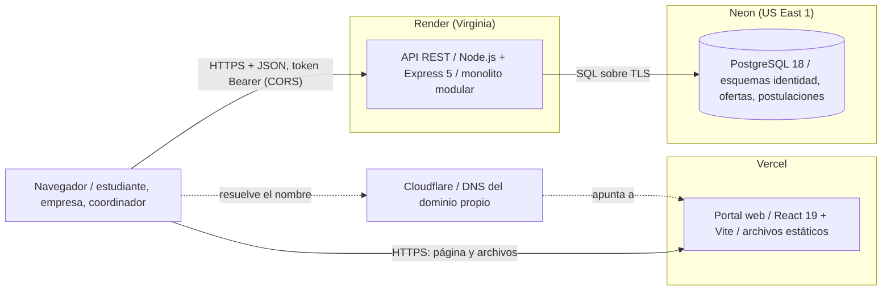
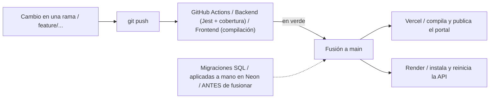

# Despliegue e integración

Sprint 3. El sistema está publicado con tres servicios, uno por capa, y se despliega de forma automática desde GitHub. Este documento describe qué hay desplegado, cómo se comunican los componentes, cómo se integra y despliega un cambio, y cómo poner el sistema en un dominio propio con Cloudflare.

## Plataforma y componentes

| Capa | Servicio | Región | Qué contiene |
|------|----------|--------|--------------|
| Interfaz web | Vercel (plan gratuito) | Global (CDN) | React 19 + Vite, carpeta `frontend`, archivos estáticos |
| API | Render (Web Service, plan gratuito) | Virginia (US East) | Node.js + Express 5, carpeta `backend`, documentación de la API en `/api-docs` |
| Base de datos | Neon (PostgreSQL 18, plan gratuito) | US East 1 (Virginia) | Esquemas `identidad`, `ofertas` y `postulaciones` |
| DNS y dominio | Cloudflare | Global | Dominio propio y registros DNS (ver «Dominio propio») |
| Código y CI | GitHub y GitHub Actions | — | Repositorio, pruebas con Jest y compilación del frontend |

## Diagrama de despliegue

El navegador carga el portal desde Vercel y ese portal llama directamente a la API en Render, que a su vez consulta Neon. Cloudflare solo resuelve el nombre del dominio: no está en el camino del tráfico (registros en «solo DNS»).



Notas sobre el diagrama:

- El portal es estático: toda la lógica de negocio vive en la API. El navegador llama a la API usando la dirección `VITE_API_URL`, que se incorpora al compilar el frontend.
- La API acepta peticiones desde un único origen, el definido en `CORS_ORIGIN`.
- La sesión es un token firmado (JWT, 8 horas) que el portal envía en la cabecera `Authorization`; la API no guarda sesiones en memoria, salvo el contador de intentos fallidos de inicio de sesión.

## Integración y despliegue continuos

Cada cambio sigue el mismo camino:



1. **Rama y pruebas.** Todo cambio se sube a una rama `feature/...` o `docs/...`. Eso ejecuta `.github/workflows/ci.yml`: el trabajo «Backend (Jest)» corre las pruebas con cobertura (y guarda el informe como artefacto `cobertura-backend`) y el trabajo «Frontend (compilación)» ejecuta `npm run build`.
2. **Fusión.** Con la CI en verde se fusiona a `main`.
3. **Despliegue automático.** Cada push a `main` vuelve a desplegar Vercel (portal) y Render (API) sin intervención.
4. **Migraciones: manuales y antes.** Los cambios de esquema **no se aplican solos**. Hay que ejecutarlos contra Neon **antes** de fusionar el código que los necesita, o la API fallará al arrancar o al consultar:

   ```
   psql "<cadena de Neon>" -f backend/migrations/0NN_nombre.sql
   ```

   Las migraciones recientes (010 a 012) son idempotentes y se pueden repetir.

## Variables de entorno

**Render (backend)**

| Variable | Valor |
|----------|-------|
| `DATABASE_URL` | Cadena de conexión de Neon (`postgresql://...?sslmode=require`). Si no se define, se usan `PGHOST`, `PGUSER`, etc. |
| `JWT_SECRET` | Clave aleatoria de 32 caracteres o más para firmar las sesiones. Sin ella el servidor no inicia. |
| `CORS_ORIGIN` | Dirección exacta del frontend, con `https://` y sin barra final. Admite **un solo** origen. |
| `PORT` | Lo asigna Render automáticamente. |

**Vercel (frontend)**

| Variable | Valor |
|----------|-------|
| `VITE_API_URL` | Dirección del backend en Render, sin barra final. Se incorpora al compilar: tras cambiarla hay que volver a desplegar. |

Las plantillas con comentarios están en `backend/.env.example` y `frontend/.env.example`. Nunca se suben claves reales al repositorio ni se pegan en chats o documentos; si una se expone, se rota en Neon y se actualiza en Render.

## Primera puesta en marcha

1. **Neon:** crear el proyecto (PostgreSQL 18, región US East 1) y copiar la cadena de conexión desde Connect → Connection string.
2. **Migraciones:** ejecutar en orden todas las de `backend/migrations` (`001` a `012`) con `psql "<cadena>" -f <archivo>`.
3. **Coordinador:** `DATABASE_URL=<cadena> COORDINADOR_CLAVE=<clave> node backend/scripts/crear-coordinador.cjs <correo> "<nombre>"`.
4. **Render:** Web Service sobre el repositorio, `Root Directory = backend`, build `npm install`, start `npm start`, con las variables de arriba.
5. **Vercel:** importar el repositorio como proyecto único con `Root Directory = frontend` y la variable `VITE_API_URL`.
6. **Render:** agregar `CORS_ORIGIN` con la dirección que asignó Vercel (o la del dominio propio, ver abajo).

## Dominio propio con Cloudflare

El dominio se compra en Cloudflare (Domain Registration → Register Domains), con plan **Gratuito**. Al comprarlo allí, su DNS ya queda en Cloudflare. Los pasos para usarlo con el sistema:

1. **Vercel:** en el proyecto, Settings → Domains → Add, y escribir el dominio o subdominio elegido (por ejemplo `practicas.<tu-dominio>.com`).
2. **Cloudflare:** en DNS → Records, crear los registros que Vercel muestra (se copian de Vercel, porque cambian con el tiempo), con el proxy en **solo DNS** (nube gris). Con el proxy activo, Vercel no puede verificar el dominio ni renovar el certificado.
3. **Vercel:** esperar a que el dominio aparezca como «Valid Configuration» y se emita el certificado (de minutos a una hora).
4. **Render:** actualizar `CORS_ORIGIN` con la dirección nueva (`https://practicas.<tu-dominio>.com`, sin barra final). Render reinicia la API solo.
5. **Comprobar** el inicio de sesión desde la dirección nueva.

La API puede seguir en `...onrender.com`: no necesita dominio propio, y entonces `VITE_API_URL` no cambia. Solo si se quiere una dirección como `api.<tu-dominio>.com` se añade en Render (Custom Domains), se crea el registro en Cloudflare y se cambia `VITE_API_URL` (con nuevo despliegue del frontend).

**Atención con CORS.** Como `CORS_ORIGIN` admite un solo origen, al activar el dominio propio la dirección `...vercel.app` deja de poder llamar a la API. Y `www.<dominio>` y `<dominio>` son orígenes distintos: debe elegirse uno como principal y redirigir el otro desde Vercel. Si un mismo dominio se comparte con otros proyectos, cada uno usa su propio subdominio y su propia configuración.

## Comprobar que el despliegue funciona

| Comprobación | Dirección | Debe verse |
|---|---|---|
| Salud de la API | `<API>/api/v1/salud` | `{"estado":"ok", ...}` |
| Conexión con la base | `<API>/api/v1/salud/db` | Respuesta correcta sin error |
| Documentación de la API | `<API>/api-docs` | Swagger UI con las 30 operaciones |
| Portal | Dirección del frontend | Pantalla de inicio de sesión |
| Flujo completo | Portal | Iniciar sesión y listar ofertas |

## Antes de una demostración

- Abrir el portal y la API unos minutos antes: Render duerme el servicio tras unos 15 minutos sin visitas y la primera petición puede tardar cerca de un minuto.
- Tener a mano una cuenta de cada rol (empresa, estudiante con créditos verificados y coordinador) y una oferta para el flujo.
- No cambiar el DNS, el `CORS_ORIGIN` ni la contraseña de la base el mismo día.

## Datos de demostración

`backend/database/002_datos_prueba_ofertas.sql` carga ofertas ficticias y `backend/database/003_limpiar_datos_demo.sql` las elimina sin tocar datos reales.

## Limitaciones del plan gratuito

- Render duerme el servicio tras unos 15 minutos sin visitas; la primera petición posterior puede tardar cerca de un minuto.
- Neon pausa el cómputo cuando no hay uso y se reactiva solo en segundos, sin perder datos.
- Los tiempos de respuesta medidos en el informe de validación son de un entorno local; en la nube cada consulta a la base suma la latencia de red entre Render y Neon.
