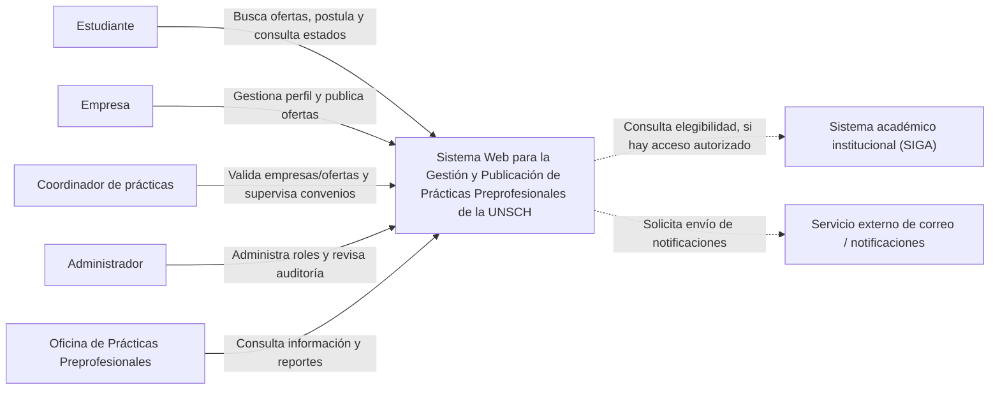
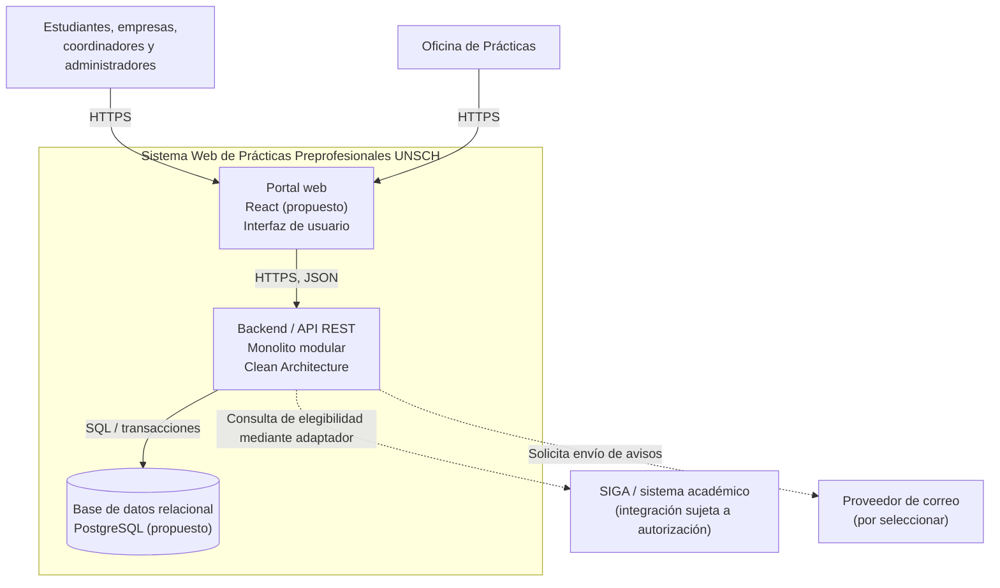
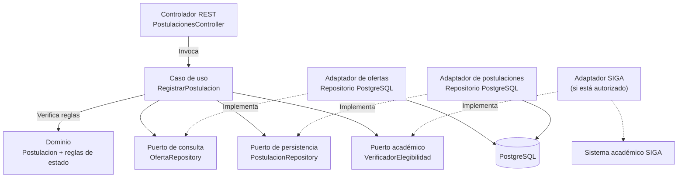
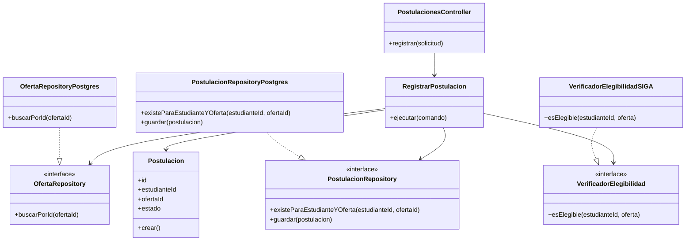

# Diagramas C4 — Sistema de Prácticas Preprofesionales UNSCH

**Estado:** propuesta arquitectónica para el Sprint 01. Los diagramas describen el diseño previsto, no una implementación ya desplegada.

## Convenciones y trazabilidad

- **RF:** requisito funcional de `../01-analisis-de-sistema/03-requisitos-funcionales.md`.
- **AC:** atributo de calidad de `../01-analisis-de-sistema/04-atributos-de-calidad.md`.
- **RC:** restricción de `../01-analisis-de-sistema/05-restricciones.md`.
- **DA:** driver arquitectónico de `../01-analisis-de-sistema/06-driver-arquitectonicos.md`.

Se mantiene un backend como monolito modular. Los módulos son límites lógicos dentro de la aplicación, no microservicios independientes.

---

## C1 — Diagrama de contexto

**Propósito:** mostrar quién utiliza el sistema y con qué sistemas externos se relaciona, sin revelar todavía los componentes internos.

### Justificación de los elementos de C1

| Elemento o relación | Origen | Justificación |
|---|---|---|
| Estudiante | HU-04, HU-05, HU-06; RF03–RF06 | Busca ofertas, postula y consulta el estado de sus procesos. |
| Empresa | HU-01, HU-03; RF01–RF02 | Se registra y gestiona ofertas de prácticas. |
| Coordinador de prácticas | HU-02, HU-06; RF01, RF06, RF09 | Valida registros/ofertas y supervisa convenios y acciones administrativas. |
| Administrador | RF08–RF09 | Gestiona permisos y revisa acciones administrativas. |
| Oficina de Prácticas | RF10 | Consume reportes y vistas generales. |
| SIGA | RF04, RC02, DA03 | Fuente potencial de datos de elegibilidad; la integración depende de autorización institucional. |
| Servicio de correo | RF07, DA05 | Canal externo propuesto para avisos; el proveedor todavía no está seleccionado. |

**Nota:** SIGA y el servicio de correo se muestran como sistemas externos previstos. No se afirma que exista una integración implementada. Si la solución institucional no autoriza acceso a SIGA, la integración debe quedar documentada como pendiente y definirse una alternativa.

---

## C2 — Diagrama de contenedores

**Propósito:** mostrar las aplicaciones ejecutables y almacenes de datos, sus responsabilidades y tecnologías propuestas. En C4, “contenedor” no significa necesariamente un contenedor Docker.

### Responsabilidad de cada contenedor

| Contenedor | Responsabilidad | Origen / justificación |
|---|---|---|
| Portal web React (propuesto) | Interfaz para cada tipo de usuario; presenta ofertas, formularios y estados. | DA01, DA05 y RF01–RF10. La tecnología es una propuesta, no una confirmación del stack implementado. |
| Backend / API REST | Autorización, reglas de negocio, casos de uso y contratos HTTP. | RF01–RF10, DA01, DA04 y DA05. |
| PostgreSQL (propuesto) | Persistir usuarios, ofertas, postulaciones, convenios y auditoría. | RF01–RF10; la selección de motor es una decisión arquitectónica propuesta. |
| SIGA externo | Proveer información académica para validar elegibilidad, si existe acceso autorizado. | RF04, RC02, DA03. |
| Proveedor de correo | Entregar avisos a usuarios. | RF07. Proveedor pendiente de selección. |

### Módulos lógicos dentro del backend

- Usuarios y Autenticación — RF08 y RF09.
- Ofertas — RF01, RF02 y RF03.
- Postulaciones — RF04, RF05 y RF06.
- Convenios — RF06 y RF10.
- Notificaciones — RF07.
- Integración Académica — RF04, RC02 y DA03.
- Reportes y Auditoría — RF09 y RF10.

Estos módulos se ejecutan dentro de un solo backend desplegable (ADR-001). Redis, RabbitMQ y una plataforma de nube no forman parte del C2 base; se evaluarán solo si hay evidencia y presupuesto que los justifique.

---

## C3 — Componentes del contenedor Backend / API REST

**Propósito:** ampliar el backend y mostrar los componentes principales y sus relaciones. El ejemplo se centra en el caso de uso de postulación porque incluye reglas de elegibilidad y prevención de duplicados.

### Responsabilidad y trazabilidad de componentes

| Componente | Responsabilidad | Requisito / driver |
|---|---|---|
| PostulacionesController | Recibir la petición HTTP, validar formato y mapear la respuesta; no contiene reglas de negocio centrales. | RF04–RF06, DA05. |
| RegistrarPostulacion | Coordinar elegibilidad, comprobación de duplicados y registro de la postulación. | RF04, RF05; DA04 y DA06. |
| Dominio Postulacion | Representar la postulación y sus reglas válidas de estado. | RF05–RF06; AC05. |
| OfertaRepository (puerto) | Definir cómo consultar una oferta sin acoplar el caso de uso a PostgreSQL. | RF02–RF04; DA06. |
| PostulacionRepository (puerto) | Definir operaciones para comprobar y guardar postulaciones. | RF05–RF06; AC05. |
| VerificadorElegibilidad (puerto) | Abstraer la comprobación de créditos/ciclo u otros criterios académicos. | RF04, RC02, DA03. |
| Adaptadores PostgreSQL | Implementar persistencia concreta. | RF01–RF10; decisión de persistencia. |
| Adaptador SIGA | Traducir el contrato interno a la integración externa, si es autorizada. | RF04, RC02, DA03. |

**Regla de integridad:** la prevención de duplicados no debe depender únicamente de una comprobación previa en el caso de uso. La implementación debe proteger también la escritura frente a solicitudes concurrentes, por ejemplo con una restricción única sobre estudiante y oferta y manejo controlado del conflicto.

---

## C4 — Diagrama de código del componente RegistrarPostulacion

**Propósito:** mostrar las clases e interfaces principales que implementan el caso de uso. Es un diseño conceptual; los nombres pueden ajustarse cuando se confirme el lenguaje y framework del backend.

### Flujo resumido del caso de uso

1. El controlador recibe la solicitud autenticada del estudiante.
2. El caso de uso busca la oferta y comprueba que exista y admita postulaciones.
3. Consulta la elegibilidad mediante `VerificadorElegibilidad`; el adaptador SIGA es una implementación prevista, condicionada a autorización y disponibilidad.
4. Comprueba si ya existe una postulación para el mismo estudiante y oferta.
5. Crea la entidad de dominio y solicita guardarla.
6. La persistencia aplica la protección contra duplicados concurrentes y el sistema devuelve un resultado claro.

### Aplicación de Clean Architecture y SOLID

- **Inversión de dependencias:** el caso de uso depende de interfaces, no de clases PostgreSQL o del cliente SIGA.
- **Responsabilidad única:** el controlador gestiona HTTP; el caso de uso coordina la operación; la entidad protege reglas de dominio; los adaptadores resuelven detalles técnicos.
- **Sustitución de implementaciones:** repositorios o verificador pueden sustituirse por dobles de prueba.
- **Pruebas:** el caso de uso debe poder probarse con repositorios simulados, sin conectar a la base de datos real ni a SIGA.

## Matriz de trazabilidad resumida

| Elemento arquitectónico | Requisitos | Calidad / restricción / driver |
|---|---|---|
| Portal web | RF01–RF10 | DA01, DA05, AC04 |
| API REST | RF01–RF10 | DA01, DA05, AC03, AC05 |
| Autenticación y roles | RF08 | AC03 |
| Módulo Ofertas | RF01–RF03 | AC02, AC04 |
| Módulo Postulaciones | RF04–RF06 | AC02, AC03, AC05 |
| Módulo Convenios | RF06, RF10 | AC04, AC05 |
| Módulo Notificaciones | RF07 | AC02 |
| Reportes y auditoría | RF09–RF10 | AC03, AC04 |
| PostgreSQL | RF01–RF10, según los datos persistidos | AC02, AC05 |
| Adaptador SIGA | RF04 | RC02, DA03 |
| Interfaces de repositorio | RF04–RF06 | DA04, DA06, AC05 |
| Protección contra duplicados | RF05 | Integridad de datos |
| Proveedor de correo | RF07 | DA05; proveedor pendiente |

## Decisiones y límites conocidos

1. La arquitectura seleccionada es monolito modular con API REST y Clean Architecture; no se proponen microservicios en esta etapa.
2. React y PostgreSQL son tecnologías propuestas en los documentos. Deben contrastarse con el repositorio de código antes de presentarlas como implementación.
3. La integración con SIGA y el proveedor de correo dependen de acceso, autorización y selección técnica.
4. El despliegue en nube se documentará en una etapa posterior, tal como se acordó para el proyecto.
5. Los diagramas C1–C4 mantienen el mismo límite de sistema, los mismos actores y nombres coherentes entre niveles.
