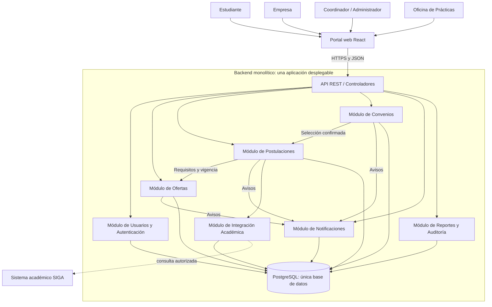

# Estilo arquitectónico

## 1. Propósito

Definir la organización global propuesta para el **Sistema Web para la Gestión y Publicación de Prácticas Preprofesionales de la UNSCH**, tomando como base los requisitos, atributos de calidad y drivers documentados en `analisis-de-sistema/`.

## 2. Estilo seleccionado

**Monolito modular con API REST y enfoque interno de Clean Architecture.**

El backend se implementará como una única aplicación desplegable, organizada en módulos con responsabilidades claras: Usuarios y Autenticación, Ofertas, Postulaciones, Convenios, Notificaciones, Integración Académica y Reportes y Auditoría. El portal web, propuesto con React, consume la API REST del backend. Los módulos comparten el mismo proceso de ejecución y, en la primera versión, una base de datos PostgreSQL, pero mantienen límites lógicos y evitan acceder directamente a la lógica interna de otros módulos.

Este estilo no significa colocar todo el código en una sola clase o carpeta. La aplicación debe separar dominio, casos de uso, presentación e infraestructura, y mantener dependencias controladas. Esta es una **propuesta arquitectónica** del repositorio, no una afirmación de que todas las tecnologías ya estén implementadas.

## 3. Drivers que motivan la decisión

- **DA01 — Centralización de procesos dispersos:** un portal web y una API consistentes reúnen los trámites de estudiantes, empresas y coordinadores.
- **DA02 — Picos de demanda estacionales:** medir búsquedas y postulaciones con 20 y 25 usuarios simultáneos, optimizando consultas PostgreSQL.
- **DA03 — Integración con sistemas legados:** aislar la comunicación con SIGA mediante un adaptador.
- **DA04 — Evolución modular:** separar capacidades del negocio en módulos dentro de una aplicación desplegable.
- **DA05 — Comunicación estandarizada:** exponer contratos HTTP propios basados en los flujos funcionales de empresas, avisos y postulaciones de Bumeran.
- **DA06 — Mantenibilidad:** controlar dependencias y reducir el impacto de los cambios.

## 4. Módulos y responsabilidades

| Módulo / componente | Responsabilidad |
|---|---|
| Portal web (React) | Presentar los flujos de estudiantes, empresas, coordinadores y administradores. |
| API REST / Presentación | Recibir solicitudes HTTP, validar datos de entrada, aplicar autenticación y autorización, y devolver respuestas. |
| Autenticación y Usuarios | Gestionar identidad, sesión o tokens y roles. |
| Ofertas | Administrar perfil y validación de empresas; crear, revisar, publicar, editar, cerrar, buscar y filtrar ofertas. Empresa y oferta tienen aprobación separada. |
| Postulaciones | Consultar oferta y elegibilidad por contratos; registrar sin duplicados; permitir evaluación, selección/rechazo y seguimiento de candidaturas. |
| Convenios | Gestionar convenios de estudiantes seleccionados y seguimiento de prácticas; mantener estados independientes de candidatura, convenio y práctica. |
| Notificaciones | Persistir avisos internos por destinatario y estado de lectura en PostgreSQL. |
| Integración Académica | Consultar elegibilidad a través de un adaptador para SIGA, si existe un mecanismo institucional autorizado. |
| Reportes y Auditoría | Registrar acciones administrativas y generar reportes por periodo y carrera (RF09, RF10). |
| PostgreSQL | Persistir la información estructurada de la aplicación mediante tablas y restricciones adecuadas. Cada módulo es dueño de sus tablas. |

Los módulos de negocio no deben importar ni modificar directamente las clases internas de otros módulos. La comunicación entre módulos se realizará mediante interfaces, servicios de aplicación o contratos internos definidos explícitamente.

## 5. Diagrama global

El diagrama representa límites lógicos dentro de una aplicación desplegable, no servicios independientes. PostgreSQL es la persistencia principal propuesta. No se incluyen Redis, RabbitMQ ni bases adicionales (ADR-003). Las notificaciones se consultan en el portal y se almacenan en PostgreSQL. La integración con SIGA depende de que la universidad habilite un mecanismo de acceso.

## 6. Ventajas esperadas

- Menor complejidad de desarrollo, despliegue y monitoreo que una arquitectura distribuida.
- Módulos con responsabilidades definidas y menor acoplamiento.
- Transacciones más sencillas para operaciones relacionadas, como registrar una postulación y validar su estado.
- Pruebas unitarias y de integración más fáciles de ejecutar en una primera versión.
- Posibilidad de separar un módulo en un servicio independiente en el futuro, si la necesidad se demuestra y sus límites están bien definidos.

## 7. Costes y riesgos

- Los módulos comparten el proceso de despliegue; una publicación del backend puede afectar a toda la aplicación.
- Si no se respetan los límites, el monolito puede volverse difícil de mantener y los módulos pueden quedar acoplados.
- El escalamiento suele hacerse inicialmente para toda la aplicación, no para un módulo aislado.
- La carga objetivo se valida con 20 y 25 usuarios simultáneos; no se presupone que el monolito cumpla los umbrales sin pruebas.
- Se deben proteger las operaciones concurrentes y definir transacciones, restricciones y permisos en la base de datos.

## 8. Criterios de validación

1. El backend se construye y despliega como una aplicación, con módulos de negocio identificables.
2. Cada módulo tiene una responsabilidad y una interfaz interna documentadas.
3. Los controladores no contienen reglas centrales del negocio.
4. La integración autorizada con SIGA está aislada detrás de un adaptador y las notificaciones internas persisten en PostgreSQL.
5. Las reglas de autorización se validan en las operaciones protegidas.
6. Las pruebas cubren permisos, elegibilidad académica, duplicidad de postulaciones y transiciones de estado.
7. La arquitectura base utiliza exclusivamente PostgreSQL; se ejecutan los escenarios de rendimiento, seguridad y mantenibilidad.

## 9. Decisión

Se selecciona **monolito modular** como estilo arquitectónico para la primera versión del sistema. La organización interna seguirá el enfoque de **Clean Architecture**, descrito en `enfoque/enfoque-arquitectonico.md`. La posible extracción futura de un módulo a un servicio independiente será una decisión posterior, sustentada en necesidades reales.
## 10. Definición de los módulos y lectura del diagrama

Se conservan los siete módulos originales. Cada caja representa una responsabilidad **dentro del mismo proceso backend**, no una aplicación independiente. React y la API son presentación; PostgreSQL es infraestructura, no un octavo módulo de negocio.

| Módulo | Entradas principales | Resultado | Límite |
|---|---|---|---|
| Usuarios y Autenticación | Credenciales, cuenta y asignaciones de rol/ámbito | Identidad autenticada y permisos | No aprueba perfiles empresariales ni oportunidades. |
| Ofertas | Perfil empresarial, decisión del coordinador, requisitos y filtros | Empresa validada, oferta aprobada/cerrada y resultados paginados | No registra postulaciones ni valida antecedentes académicos. |
| Postulaciones | Identidad estudiantil, oferta, verificación académica y evaluación empresarial | Candidatura única y estado de selección | No activa convenios ni prácticas. |
| Convenios | Selección confirmada, documento y decisiones del coordinador | Estado del convenio y seguimiento de la práctica | No mezcla esos estados con los de candidatura. |
| Notificaciones | Avisos solicitados por casos de uso | Notificación interna para cada destinatario y lectura | No toma decisiones del negocio ni requiere un servicio externo. |
| Integración Académica | Identificador del estudiante y requisitos | Resultado de elegibilidad o error/indisponibilidad explícitos | No reemplaza SIGA ni convierte una falla en aprobación. |
| Reportes y Auditoría | Contratos de consulta y acciones administrativas | Dashboard/exportaciones y registro trazable | No modifica datos internos de los demás módulos. |

La explicación de datos propios, operaciones y contratos de cada uno está en [Definición detallada de los siete módulos](arquitectura-inicial.md#definición-detallada-de-los-siete-módulos).

En el diagrama, las flechas entre módulos son llamadas por contratos en memoria. Las flechas a PostgreSQL corresponden a adaptadores propios de cada módulo; ninguna autoriza a consultar tablas ajenas. Para mantener legibilidad no se dibujan todas las llamadas a auditoría: las decisiones administrativas relevantes deben registrarse aunque esa relación no aparezca individualmente.

## 11. Ejemplo completo del funcionamiento

1. La empresa inicia sesión mediante Usuarios y Autenticación.
2. Ofertas comprueba que su perfil empresarial esté aprobado; registra la oportunidad y la remite a revisión del coordinador.
3. El coordinador aprueba la oferta; Ofertas habilita su visibilidad y solicita avisos internos a Notificaciones.
4. El estudiante consulta ofertas compatibles desde React mediante la API REST.
5. Postulaciones consulta requisitos/vigencia a Ofertas y elegibilidad a Integración Académica. Si la verificación está disponible y cumple, guarda la candidatura sin duplicados en PostgreSQL.
6. La empresa evalúa y selecciona en Postulaciones; el coordinador gestiona después el convenio y el seguimiento de práctica en Convenios.
7. Reportes y Auditoría registra decisiones sensibles y permite a la Oficina consultar indicadores.

## 12. Bumeran como referencia funcional

Los flujos de candidato, empresa, aviso y postulación orientan la interfaz y las operaciones de nuestra API REST. El [C2](diagramas-c4/diagramas-c4.md) muestra esa correspondencia funcional y [API REST](api-rest.md) detalla nuestras rutas propuestas. No se atribuye este monolito ni PostgreSQL a la implementación interna de Bumeran.

Los tres atributos priorizados son AC01 Rendimiento, AC02 Seguridad y AC03 Mantenibilidad. La carga objetivo es 20 y 25 usuarios simultáneos y las mediciones siguen pendientes.
